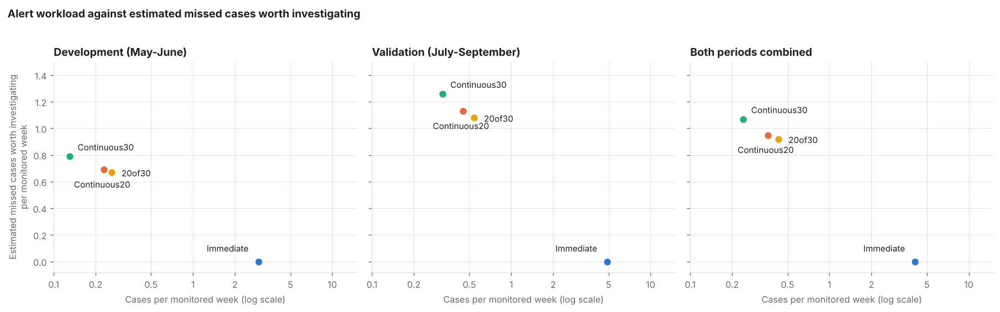
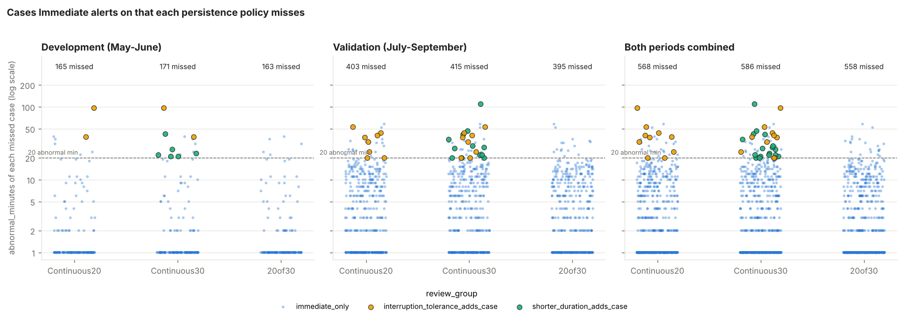

# Step 3: four alert policies side by side (development and validation)

Generated by `step3_policy_comparison.py`; the written trade-off analysis is in `STEP3_TRADEOFFS.md`.
Development is May-June, validation July-September; October-December is not read. Cases are excursion
cases, not confirmed faults. This step compares; it does not select a policy (step 4).

## Table 1. Cases, cases missed and delay per monitored week

Cases missed are cases Immediate alerts on that the policy does not.

| period | policy | monitored_weeks | cases | cases_per_monitored_week | cases_missed | cases_missed_per_monitored_week | cases_missed_%_of_immediate | average_delay_min | median_delay_min | total_delay_min | total_delay_min_per_monitored_week |
|---|---|---|---|---|---|---|---|---|---|---|---|
| development | Immediate | 60.7 | 179 | 2.95 | 0 | 0.0 | 0.0 | 0.0 | 0.0 | 0 | 0.0 |
| development | Continuous20 | 60.7 | 14 | 0.23 | 165 | 2.72 | 92.2 | 19.4 | 19.0 | 271 | 4.5 |
| development | Continuous30 | 60.7 | 8 | 0.13 | 171 | 2.82 | 95.5 | 34.8 | 29.0 | 278 | 4.6 |
| development | 20of30 | 60.7 | 16 | 0.26 | 163 | 2.69 | 91.1 | 23.5 | 19.0 | 376 | 6.2 |
| validation | Immediate | 91.1 | 444 | 4.88 | 0 | 0.0 | 0.0 | 0.1 | 0.0 | 34 | 0.4 |
| validation | Continuous20 | 91.1 | 41 | 0.45 | 403 | 4.43 | 90.8 | 24.1 | 19.0 | 988 | 10.9 |
| validation | Continuous30 | 91.1 | 29 | 0.32 | 415 | 4.56 | 93.5 | 34.8 | 29.0 | 1009 | 11.1 |
| validation | 20of30 | 91.1 | 49 | 0.54 | 395 | 4.34 | 89.0 | 23.5 | 19.0 | 1151 | 12.6 |

### Table 1b. The same, development and validation combined

Pooled: cases, cases missed and delay minutes are added across both periods and divided by the total
monitored weeks.

| policy | monitored_weeks | cases | cases_per_monitored_week | cases_missed | cases_missed_per_monitored_week | cases_missed_%_of_immediate | average_delay_min | median_delay_min | total_delay_min | total_delay_min_per_monitored_week |
|---|---|---|---|---|---|---|---|---|---|---|
| Immediate | 151.8 | 623 | 4.11 | 0 | 0.0 | 0.0 | 0.1 | 0.0 | 34 | 0.2 |
| Continuous20 | 151.8 | 55 | 0.36 | 568 | 3.74 | 91.2 | 22.9 | 19.0 | 1259 | 8.3 |
| Continuous30 | 151.8 | 37 | 0.24 | 586 | 3.86 | 94.1 | 34.8 | 29.0 | 1287 | 8.5 |
| 20of30 | 151.8 | 65 | 0.43 | 558 | 3.68 | 89.6 | 23.5 | 19.0 | 1527 | 10.1 |

## Table 2. Step-1 plots each policy alerts on, by step 1 rating

Case plots only (16); the 4 random_no_threshold_excursion control windows are counted separately.

| policy | plots_alerted | rated_investigate | rated_investigate_% | rated_monitor | rated_monitor_% | rated_uncertain | review_ids_alerted | control_windows_alerted |
|---|---|---|---|---|---|---|---|---|
| Immediate | 16 | 11 | 68.8 | 5 | 31.2 | 0 | R01 R03 R04 R05 R06 R07 R08 R11 R12 R13 R15 R16 R17 R18 R19 R20 | 0 |
| Continuous20 | 8 | 8 | 100.0 | 0 | 0.0 | 0 | R05 R06 R07 R13 R15 R17 R18 R20 | 0 |
| Continuous30 | 4 | 4 | 100.0 | 0 | 0.0 | 0 | R05 R07 R13 R18 | 0 |
| 20of30 | 12 | 10 | 83.3 | 2 | 16.7 | 0 | R01 R04 R05 R06 R07 R08 R12 R13 R15 R17 R18 R20 | 0 |

## Table 3. Step-2 controlled tests (threshold-crossing test)

| pattern | Immediate | Continuous20 | Continuous30 | 20of30 |
|---|---|---|---|---|
| 1-minute spike | detected, 0 min | not detected | not detected | not detected |
| 5-minute spike | detected, 0 min | not detected | not detected | not detected |
| 10 continuous minutes | detected, 0 min | not detected | not detected | not detected |
| 20 continuous minutes | detected, 0 min | detected, 19 min | not detected | detected, 19 min |
| 25 continuous minutes | detected, 0 min | detected, 19 min | not detected | detected, 19 min |
| 30 continuous minutes | detected, 0 min | detected, 19 min | detected, 29 min | detected, 19 min |
| 60 continuous minutes | detected, 0 min | detected, 19 min | detected, 29 min | detected, 19 min |
| 19 on, 1 off, 19 on | detected, 0 min | not detected | not detected | detected, 20 min |
| 10 on, 5 off, 10 on | detected, 0 min | not detected | not detected | detected, 24 min |
| 2 on / 1 off for 30 minutes | detected, 0 min | not detected | not detected | detected, 28 min |
| 3 on / 3 off pulses | detected, 0 min | not detected | not detected | not detected |
| 5 on / 10 off cycles | detected, 0 min | not detected | not detected | not detected |
| patterns detected | 12 of 12 | 4 of 12 | 2 of 12 | 7 of 12 |

Fixed +1/+5/+10 kW results: `table3b_step2_fixed_magnitude.csv`.

## Table 4. Missed-pattern severity, by review_group (full data)

Step 1 investigate share per review_group (each rests on 4 plots):

| review_group | plots | rated_investigate | investigate_share |
|---|---|---|---|
| immediate_only | 4 | 1 | 0.25 |
| interruption_tolerance_adds_case | 4 | 2 | 0.5 |
| shared_sustained_case | 4 | 4 | 1.0 |
| shorter_duration_adds_case | 4 | 4 | 1.0 |

| period | policy | review_group | cases_missed | cases_missed_per_monitored_week | abnormal_minutes_median | abnormal_minutes_max | longest_abnormal_run_median | longest_abnormal_run_max | reviewer_plots_in_group | reviewer_rated_investigate | investigate_share | estimated_missed_worth_investigating |
|---|---|---|---|---|---|---|---|---|---|---|---|---|
| development | Continuous20 | immediate_only | 163 | 2.69 | 1.0 | 39 | 1.0 | 19 | 4 | 1 | 0.25 | 40.8 |
| development | Continuous20 | interruption_tolerance_adds_case | 2 | 0.03 | 68.0 | 97 | 12.0 | 13 | 4 | 2 | 0.5 | 1.0 |
| development | Continuous30 | immediate_only | 163 | 2.69 | 1.0 | 39 | 1.0 | 19 | 4 | 1 | 0.25 | 40.8 |
| development | Continuous30 | shorter_duration_adds_case | 6 | 0.1 | 22.5 | 43 | 22.0 | 25 | 4 | 4 | 1.0 | 6.0 |
| development | Continuous30 | interruption_tolerance_adds_case | 2 | 0.03 | 68.0 | 97 | 12.0 | 13 | 4 | 2 | 0.5 | 1.0 |
| development | 20of30 | immediate_only | 163 | 2.69 | 1.0 | 39 | 1.0 | 19 | 4 | 1 | 0.25 | 40.8 |
| validation | Continuous20 | immediate_only | 395 | 4.34 | 3.0 | 58 | 3.0 | 19 | 4 | 1 | 0.25 | 98.8 |
| validation | Continuous20 | interruption_tolerance_adds_case | 8 | 0.09 | 35.5 | 53 | 16.5 | 19 | 4 | 2 | 0.5 | 4.0 |
| validation | Continuous30 | immediate_only | 395 | 4.34 | 3.0 | 58 | 3.0 | 19 | 4 | 1 | 0.25 | 98.8 |
| validation | Continuous30 | shorter_duration_adds_case | 12 | 0.13 | 27.5 | 110 | 24.0 | 28 | 4 | 4 | 1.0 | 12.0 |
| validation | Continuous30 | interruption_tolerance_adds_case | 8 | 0.09 | 35.5 | 53 | 16.5 | 19 | 4 | 2 | 0.5 | 4.0 |
| validation | 20of30 | immediate_only | 395 | 4.34 | 3.0 | 58 | 3.0 | 19 | 4 | 1 | 0.25 | 98.8 |

Totals:

| period | policy | cases_missed | estimated_missed_worth_investigating | estimated_missed_worth_investigating_per_monitored_week |
|---|---|---|---|---|
| development | Continuous20 | 165 | 41.8 | 0.69 |
| development | Continuous30 | 171 | 47.8 | 0.79 |
| development | 20of30 | 163 | 40.8 | 0.67 |
| validation | Continuous20 | 403 | 102.8 | 1.13 |
| validation | Continuous30 | 415 | 114.8 | 1.26 |
| validation | 20of30 | 395 | 98.8 | 1.08 |

Both periods combined (pooled over the total monitored weeks):

| policy | cases_missed | immediate_only_missed | interruption_tolerance_adds_case_missed | shorter_duration_adds_case_missed | immediate_only_missed_x_investigate_share | interruption_tolerance_adds_case_missed_x_investigate_share | shorter_duration_adds_case_missed_x_investigate_share | estimated_missed_worth_investigating | estimated_missed_worth_investigating_per_monitored_week |
|---|---|---|---|---|---|---|---|---|---|
| Continuous20 | 568 | 558 | 10 | 0 | 139.5 | 5.0 | 0.0 | 144.5 | 0.95 |
| Continuous30 | 586 | 558 | 10 | 18 | 139.5 | 5.0 | 18.0 | 162.5 | 1.07 |
| 20of30 | 558 | 558 | 0 | 0 | 139.5 | 0.0 | 0.0 | 139.5 | 0.92 |

